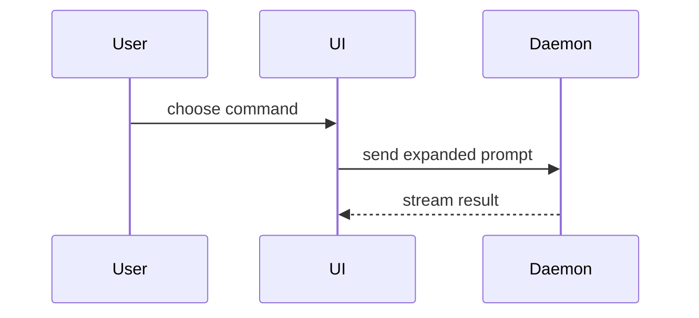

Используй этот шаблон для написания тела PR:

```markdown
## Сводка

<диаграмма, diff-скетч или дерево>

## Доказательства

- **До:** <скриншот/вывод/упавший прогон тестов>
  **После:** <скриншот/вывод/прошедший прогон тестов>

## Риск мержа

**Дверь:** <односторонняя или двусторонняя>

<опционально: описание>

**Радиус поражения:** <описание одним словом>

<опционально: потенциальные последствия мержа>
```

## Разделы

Пропускай все преамбулы и держи прозу краткой. Используй доменный язык пользователя из `GLOSSARY.md`.

### Сводка

Выбери наименьшее представление, которое делает ключевой момент ясным.

- Покажи логику или алгоритм как псевдокод:

```text
on(save)
  if content is unchanged
    return cached result
  write new content
  return fresh result
```

- Покажи поток управления во время выполнения как дерево вызовов:

```text
submitForm
  createSession
    persistPrompt
    launchAgent
  navigateToSession
```

- Покажи структуру UI как дерево компонентов, включая состояние и значимые границы модулей:

```text
<SessionPage> (apps/example/src/routes/session.tsx)
  useSessionEvents()
  <SessionToolbar>
    <RunSkillButton> (packages/ui)
```

- Покажи ответственность файлов или широкий рефакторинг как неглубокое дерево файлов:

```text
src/
├── commands/       # разбирает действия пользователя
├── sessions/       # владеет состоянием сессии
└── transport/      # отправляет API-запросы
```

- Покажи взаимодействие компонентов, поток управления или поток данных через Mermaid:



- Используй `diff`, когда суть в том, что меняется, а окружающая форма уже есть. Подгоняй форму diff под тему.

Для изменения компонента:

```diff
 <SessionPage>
   useSessionEvents()
   <SessionToolbar>
+    <RunSkillButton />
   <SessionTimeline>
+    <SkillResultCard />
```

Для изменения раскладки файлов:

```diff
 src/
 ├── commands/
+│   └── show-me.ts       # разворачивает слэш-команду
 ├── sessions/
-└── transport.ts
+└── transport/
+    ├── client.ts
+    └── stream.ts
```

Для изменения дерева или стека вызовов:

```diff
 submitForm
   createSession
     persistPrompt
+    expandSkillMention
     launchAgent
-  navigateToSession
+  navigateToSession
+    subscribeToEvents
```

Для изменения состояния или потока управления:

```diff
 on(save)
-  write content
+  if content is unchanged
+    return cached result
+  write new content
+  invalidate cache
```

- Показывай блок целиком, когда большая его часть новая, когда опущенный контекст скрыл бы владение или порядок, или когда пользователю нужна копируемая целевая форма:

```ts
function expandSkill(command: string): string {
  const skillName = command.slice(1);
  return `use the ${skillName} skill`;
}
```

#### Рекомендации

Ставь каждый визуал рядом с коротким текстом, который он поддерживает. Оставляй только вызовы, файлы, пропсы, состояния и границы, нужные для ответа на текущий вопрос пользователя или для вариантов решения текущего пункта обсуждения.

Можешь использовать один из них, можешь несколько — вряд ли понадобятся все. Полагайся на своё суждение и не перегружай пользователя.

### Доказательства

Конкретные доказательства того, что изменение работает. Покажи «до» и «после».

Скриншоты — S-уровень, когда окружение для этого настроено и изменение визуальное.

Доказательства на основе выполнения — A-уровень. Результаты тестов, вывод в консоль. Покажи точный тест, который теперь падает и проходит, через псевдокод.

### Риск мержа

Опиши, односторонняя это дверь или двусторонняя. Через двусторонние двери можно вернуться, через односторонние — нет. PR, который дёшево откатить, менее рискован. Изменения, связанные с деструктивными действиями или трудно обратимыми решениями, — односторонние двери.

Радиус поражения — потенциальное влияние или охват изменений, вносимых этим PR. Рассмотри все возможности. Примеры: сдвиг раскладки, поломки для потребителей, мобильная адаптивность и т. п.
